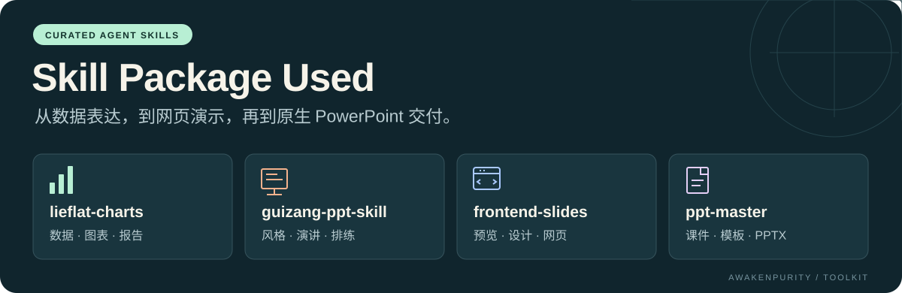

<a id="top"></a>

<div align="center">



# Skill Package Used

**把数据讲清楚，把演示做漂亮，把交付做对。**

四个精选 Agent Skills · 中文使用指南 · 差异化选型 · 固定版本管理


[快速选择](#choose) · [能力对比](#compare) · [项目介绍](#skills) · [开始使用](#start) · [许可与来源](#licenses)

</div>

---

这是一个面向**课程制作、论文分享、技术演讲与数据汇报**的个人 Skill 集合。它们并非四个同质化的“PPT 生成器”：有的优先解决数据表达，有的重视网页演讲体验，有的以原生 PowerPoint 交付为核心。

> **收录方式：Git 子模块，固定到明确的上游提交。**  
> 本仓库保存导航、说明和版本引用；四个项目的完整源码通过递归克隆取得，未改写上游 Skill。GitHub 的 **Download ZIP 不包含子模块源码**，请使用下方命令。

<a id="choose"></a>
## 🎯 先选交付物，再选 Skill

<table>
<tr>
<td width="50%" valign="top">
<h3>01 · 数据与证据</h3>
<strong>lieflat-charts</strong><br><br>
把 CSV、实验结果和指标整理成图表、数据故事与整页报告。<br>
<strong>适合：</strong>实验对比、统计图、研究简报。<br><br>
<a href="skills/lieflat-charts">进入项目 →</a>
</td>
<td width="50%" valign="top">
<h3>02 · 现场演讲</h3>
<strong>guizang-ppt-skill</strong><br><br>
用杂志风或瑞士风呈现观点，配合讲稿、双屏与计时排练。<br>
<strong>适合：</strong>主题分享、发布会、产品演示。<br><br>
<a href="skills/guizang-ppt-skill">进入项目 →</a>
</td>
</tr>
<tr>
<td width="50%" valign="top">
<h3>03 · 网页视觉探索</h3>
<strong>frontend-slides</strong><br><br>
先看风格预览再选择设计，也能把已有 PPT 的内容转为网页演示。<br>
<strong>适合：</strong>在线分享、视觉改版、PPT 转网页。<br><br>
<a href="skills/frontend-slides">进入项目 →</a>
</td>
<td width="50%" valign="top">
<h3>04 · 原生 PPTX 交付</h3>
<strong>ppt-master</strong><br><br>
生成可在 PowerPoint 中继续修改的演示，支持模板、备注与动画等能力。<br>
<strong>适合：</strong>课程课件、论文汇报、正式交付。<br><br>
<a href="skills/ppt-master">进入项目 →</a>
</td>
</tr>
</table>

**我的选用建议：** 要交付可编辑的课程 PPT，优先选 **ppt-master**；要把数据讲清楚，考虑 **lieflat-charts**；要现场演讲与排练，考虑 **guizang-ppt-skill**；要探索多种设计风格或把 PPT 搬到浏览器，考虑 **frontend-slides**。这些是基于项目定位的选型建议，不是性能排名。

<a id="compare"></a>
## 🆚 四者到底有什么区别？

| 维度 | lieflat-charts | guizang-ppt-skill | frontend-slides | ppt-master |
| :--- | :--- | :--- | :--- | :--- |
| **核心任务** | 数据可视化与数据叙事 | 风格鲜明的网页演讲 | 风格探索与网页幻灯片 | 原生 PowerPoint 生成与编辑 |
| **主要交付** | HTML 图表/报告；HTML、PDF 演示 | 单文件 HTML 演示、配图与封面 | HTML 演示；已有 PPT 转网页 | 可编辑 `.pptx`；默认流程含 SVG 页面预览 |
| **最显著差异** | 先按数据结构选图，再组织叙事 | 两套视觉系统 + 完整演讲者运行时 | 先生成视觉预览，让用户选风格 | 以原生 DrawingML 对象承载页面 |
| **视觉语言** | Lupi / Basics / Glance；Mono 与受控配色 | 电子杂志 × 电子墨水；瑞士国际主义 | 多风格预设、Bold 模板与自定义方向 | 内容驱动设计，可复用现有 PPTX 模板 |
| **如何编辑** | 修改 HTML、数据与 SVG/图表代码 | 修改 HTML/CSS/JS 和素材 | 修改 HTML/CSS/JS 和素材 | 在 PowerPoint 中编辑文字、形状等对象 |
| **播放与交互** | 图表交互；演示模式支持翻页 | 双窗口、备注、计时、排练、激光笔等 | 浏览器播放、入场动效、固定 16:9 画布 | PowerPoint 原生转场/动画；可选旁白 |
| **需要留意** | 不是原生 PPTX 输出工具；部分模板依赖联网 | 上游不建议用于密集表格或高密度培训课件 | PPT → HTML 不等于原版动画与母版逐项保真 | Python 与配套依赖；高级效果需检查目标客户端 |
| **上游许可** | PolyForm Noncommercial 1.0.0 | AGPL-3.0 | MIT | MIT（第三方依赖另计） |

> **“可编辑”要说清楚。** HTML 源码可编辑，不等于 PowerPoint 原生对象可编辑；SVG 是矢量表达，也不自动等同于带数据源的原生图表。  
> 在 ppt-master 中，图表/表格默认可按形状编辑；需要 PowerPoint 的“编辑数据”能力时，要明确请求原生 Chart / Table 导出，并按上游文档使用对应选项。图片里的文字也不会因为装进 PPTX 就自动变成文本框。

<a id="skills"></a>
## 🧩 每个 Skill 怎么用？

<details open>
<summary><strong>01 · lieflat-charts｜让数据成为能读懂的证据</strong></summary>

**用途：** 将结构化数据变为图表、交互数据故事、整页 HTML 报告；明确要求演示时，可进入 HTML/PDF 演示模式。

**与其他三个的区别：** 它先考虑数据单位、图型与信息编码，再考虑整页排版；默认任务是图表，而不是整套幻灯片。部分实现使用原生 SVG，另一些使用 Chart.js / ECharts，不能把所有结果都当作独立 SVG。

**示例请求**

```text
请使用 lieflat-charts，将这份实验结果做成 3 张中文图表：
比较模型表现、展示消融差异、解释误差分布。
保留原始单位、样本量与来源，不虚构缺失数据。
交付 HTML；需要可编辑 SVG 的图请单独确认实现方式。
```

[上游仓库](https://github.com/larashero3-dotcom/lieflat-charts) · [固定版本 Skill 入口](https://github.com/larashero3-dotcom/lieflat-charts/blob/4b4e75bde11cbef44263de769f3705db54bbb277/SKILL.md) · [本仓库收录目录](skills/lieflat-charts)

</details>

<details>
<summary><strong>02 · guizang-ppt-skill｜把观点组织成一场演讲</strong></summary>

**用途：** 生成横向翻页的网页演示，补齐讲稿与排练功能；也覆盖配图、截图适配与多平台封面。

**与 frontend-slides 的区别：** 更强调两套明确的视觉体系，以及现场演讲体验：观众屏同步、当前页/下一页、备注、计时、排练和标注。frontend-slides 更强调多风格预览和选型。

**示例请求**

```text
请使用 guizang-ppt-skill，将这份文章做成 8 页瑞士风 HTML 演讲稿。
每页只讲一个核心观点，补充连贯的口语讲稿、转场和计划时长，
保留演讲者模式，并检查在投影时的字号和对比度。
```

**边界：** 更适合由讲者带领的分享。对密集表格、阅读型培训资料和原生 PPTX 交付，不应只凭“PPT”这个名字选择它。

[上游仓库](https://github.com/op7418/guizang-ppt-skill) · [固定版本 Skill 入口](https://github.com/op7418/guizang-ppt-skill/blob/93d21bf4a73a851907a6eb00acbf30618236667a/SKILL.md) · [本仓库收录目录](skills/guizang-ppt-skill)

</details>

<details>
<summary><strong>03 · frontend-slides｜先看到风格，再决定设计</strong></summary>

**用途：** 从零生成网页演示、改进已有 HTML 演示，或提取已有 PPT 的内容与素材后重建为网页演示。

**与 guizang-ppt-skill 的区别：** 核心体验是视觉探索：通常先提供三种预览，再按选中的方向完成整套设计。它包含多种安全预设与可选 Bold 模板，强调无需构建的 HTML/CSS/JS 交付。

**示例请求**

```text
请使用 frontend-slides，把这份论文分享材料做成 HTML 演示。
先给我三种封面风格预览：学术编辑风、深色技术风和大胆视觉风。
选定后再展开正文，保持 16:9 画布，并检查桌面与手机显示。
```

**边界：** 这里的“PPT 转换”主要指 PPT → HTML，不是 HTML → 可编辑 PPTX；内容转换后仍需核对图表、公式、布局与动画。

[上游仓库](https://github.com/zarazhangrui/frontend-slides) · [固定版本 Skill 入口](https://github.com/zarazhangrui/frontend-slides/blob/9906a34d640d2111f724544cbc50f7f130569ae1/SKILL.md) · [本仓库收录目录](skills/frontend-slides)

</details>

<details>
<summary><strong>04 · ppt-master｜面向正式交付的原生 PowerPoint</strong></summary>

**用途：** 从主题或文档生成原生 PPTX，创建或套用模板，编辑已有演示，并按需求增加讲稿、旁白或动画。

**与其他三个的区别：** 主要交付就是 PowerPoint 文件，重点在后续办公编辑能力。它的 Skill 不在仓库根目录，而在 `skills/ppt-master/SKILL.md`。

**示例请求**

```text
请使用 ppt-master，为 Agent 入门课程制作一套 16:9 中文课件。
文字、流程图、框架图尽量使用可编辑对象；
数据图表需要原生图表时请显式启用对应导出方式。
每页备注写成可直接讲授的连贯讲稿，最终交付 PPTX，
并检查文字溢出、图表数据、动画和参考文献。
```

**边界：** 可编辑形状与可编辑数据的原生图表是不同交付；SVG 预览也不等于成品。旁白、生图与部分转换功能可能需要额外依赖或服务，按所用功能检查上游说明。

[上游仓库](https://github.com/hugohe3/ppt-master) · [固定版本 Skill 入口](https://github.com/hugohe3/ppt-master/blob/3af3e8ef774c4d67ee57e1306d9256d08c9ee1bf/skills/ppt-master/SKILL.md) · [本仓库收录目录](skills/ppt-master)

</details>

<a id="start"></a>
## 🚀 开始使用

### 1. 一次获取四个项目

需要先安装 Git。以下命令适用于 PowerShell、macOS 或 Linux 终端：

```bash
git clone --recurse-submodules https://github.com/AwakenPurity/skill-package-used.git
cd skill-package-used
```

如果已经普通克隆过本仓库，补运行：

```bash
git submodule update --init --recursive
```

### 2. 让 Agent 读取对应入口

| 你要使用的项目 | 克隆后的入口路径 |
| :--- | :--- |
| lieflat-charts | `skills/lieflat-charts/SKILL.md` |
| guizang-ppt-skill | `skills/guizang-ppt-skill/SKILL.md` |
| frontend-slides | `skills/frontend-slides/SKILL.md` |
| ppt-master | `skills/ppt-master/skills/ppt-master/SKILL.md` |

例如，在能读写本地文件的 Agent 中打开本仓库后：

```text
请读取 skills/ppt-master/skills/ppt-master/SKILL.md，
根据该入口及其引用文件，为我制作课程 PPT。
```

**克隆不等于安装，也不会自动配置模型或 API。** 可以先让 Agent 按路径读取；如需注册成长期可用的 Skill，再按各项目上游 README 的安装方式操作。需要依赖时，使用独立环境并按选中项目的说明安装。

### 3. 日常同步与升级

同步本仓库记录的版本：

```bash
git pull --ff-only
git submodule update --init --recursive
```

子模块会检出固定提交，出现 detached HEAD 是正常现象。主动升级到上游新版本、核对许可并更新版本清单的流程，见 [维护说明](docs/MAINTENANCE.md)。

<a id="licenses"></a>
## 📚 来源、版本与许可

本仓库是**第三方项目集合与中文导航**，不声称拥有上游作品。四个项目分别适用自己的许可，没有统一改成 MIT。尤其是 lieflat-charts 的公开可读源码受非商业许可约束，不能据此认为可自由商用。

| 项目 / 作者 | 记录版本 | 许可入口 |
| :--- | :--- | :--- |
| [larashero3-dotcom/lieflat-charts](https://github.com/larashero3-dotcom/lieflat-charts) | [`4b4e75bd`](https://github.com/larashero3-dotcom/lieflat-charts/commit/4b4e75bde11cbef44263de769f3705db54bbb277) | [PolyForm-Noncommercial-1.0.0](https://github.com/larashero3-dotcom/lieflat-charts/blob/4b4e75bde11cbef44263de769f3705db54bbb277/LICENSE) |
| [op7418/guizang-ppt-skill](https://github.com/op7418/guizang-ppt-skill) | [`93d21bf4`](https://github.com/op7418/guizang-ppt-skill/commit/93d21bf4a73a851907a6eb00acbf30618236667a) | [AGPL-3.0](https://github.com/op7418/guizang-ppt-skill/blob/93d21bf4a73a851907a6eb00acbf30618236667a/LICENSE) |
| [zarazhangrui/frontend-slides](https://github.com/zarazhangrui/frontend-slides) | [`9906a34d`](https://github.com/zarazhangrui/frontend-slides/commit/9906a34d640d2111f724544cbc50f7f130569ae1) | [MIT](https://github.com/zarazhangrui/frontend-slides/blob/9906a34d640d2111f724544cbc50f7f130569ae1/LICENSE) |
| [hugohe3/ppt-master](https://github.com/hugohe3/ppt-master) | [`3af3e8ef`](https://github.com/hugohe3/ppt-master/commit/3af3e8ef774c4d67ee57e1306d9256d08c9ee1bf) | [MIT](https://github.com/hugohe3/ppt-master/blob/3af3e8ef774c4d67ee57e1306d9256d08c9ee1bf/LICENSE) |

能力说明以收录版本的 README / SKILL 为依据；示例请求和选型建议由本集合整理，未宣称完成四套工具的全功能实测。上游后续变化不自动改变这里锁定的版本。

[机器可读版本清单](skills.lock.json) · [第三方说明](THIRD_PARTY_NOTICES.md) · [维护说明](docs/MAINTENANCE.md)

---

<div align="center">
<sub>Curated by AwakenPurity · 尊重原作者，选择适合交付目标的工具。</sub><br>
<a href="#top">返回顶部 ↑</a>
</div>
